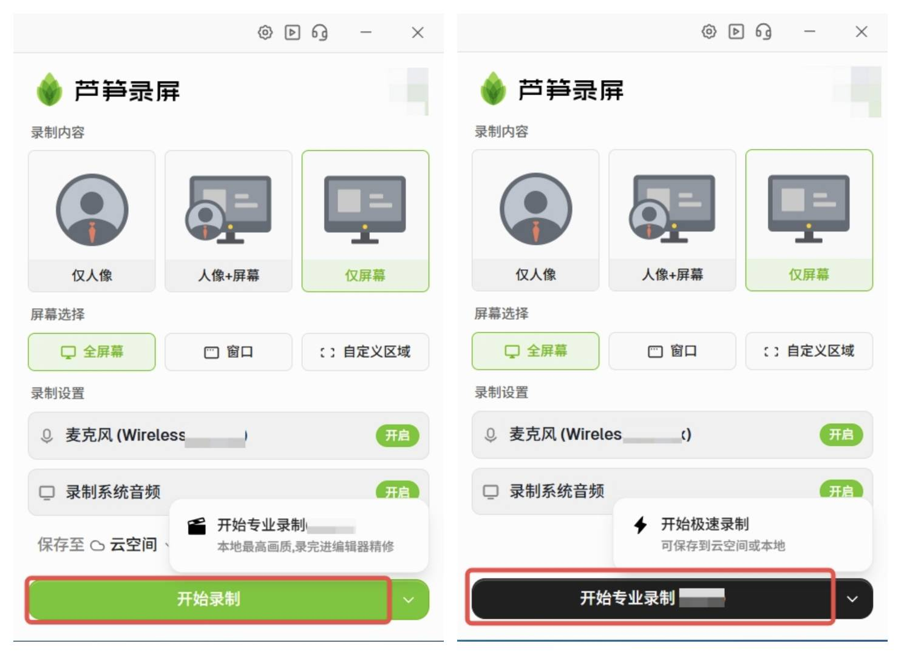

# 两种录制方式

芦笋录屏支持**极速录制**和**专业录制**两种方式。

**极速录制**：边录边传，视频可以直接上传到云空间或者保存到本地。

**专业录制**：录制完成后，可以进入编辑器精修视频。

<ImgCenter></ImgCenter>
<ImgDesc>两种录制方式</ImgDesc>

# 视频教程

## 极速模式

<iframe src="https://lusun.com/embed/?id=trKjV4SNY5y" width="100%" height="500px" scrolling="no" border="0" frameborder="no" framespacing="0" allowfullscreen="true"></iframe>

## 专业模式

<iframe src="https://lusun.com/embed/?id=4KvbmBSvFJw" width="100%" height="500px" scrolling="no" border="0" frameborder="no" framespacing="0" allowfullscreen="true"></iframe>

***

芦笋录屏官网：请访问 [lusun.com](https://lusun.com)

***

推荐更多教程供你参考：[电脑端攻略](../basic/pc.md)｜[手机端攻略](../basic/phone.md)｜[会员特权](../basic/vip.md)｜[联系我们](../contact.md)
